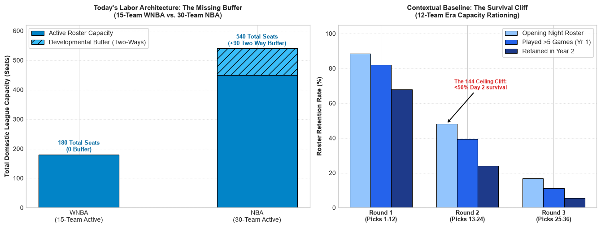
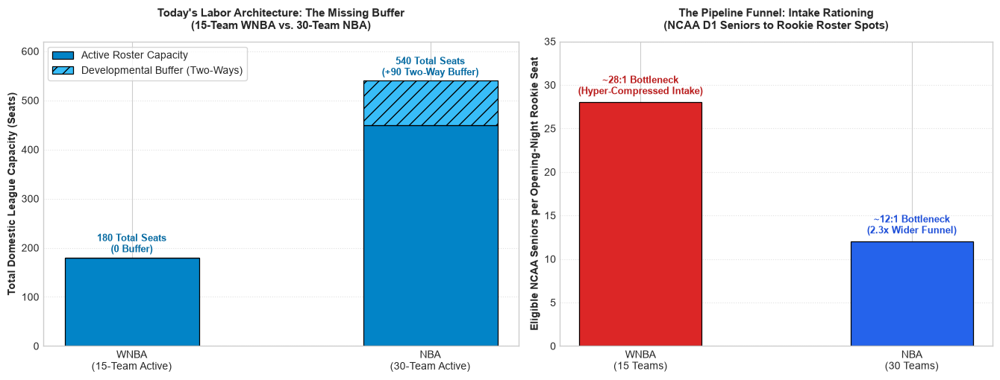

# Headcount Deficit

A small exploratory project that asks: **does the WNBA have enough roster seats for the talent it drafts?**

It compares total league roster capacity in the WNBA and the NBA, looks at how many draft picks survive their rookie year, and estimates how many eligible NCAA seniors compete for each opening-night rookie seat.

## Contents

| File | Description |
| --- | --- |
| `eda.ipynb` | Analysis notebook (two two-panel charts) |
| `figures/` | Charts exported from the notebook |

### Data

The notebook has no external data files. Every figure is typed directly into the notebook cells as a list or array:

| Variable | Cell | Description |
| --- | --- | --- |
| `active_core` | 1, 2 | Active roster seats per league: WNBA 15 teams × 12 = 180, NBA 30 teams × 15 = 450 |
| `shock_absorbers` | 1, 2 | Two-way contract seats: WNBA 0, NBA 30 teams × 3 = 90 |
| `draft_retention` | 1 | Share of picks by draft round who made the opening roster, played more than 5 games in Year 1, and were still in the league in Year 2 |
| `funnel_ratios` | 2 | Eligible NCAA D1 seniors per opening-night rookie seat: WNBA ~28, NBA ~12 |

## Method

The notebook has two chart cells. Both use the same first panel.

1. **Capacity (Panel A, both cells).** A stacked bar chart of total league seats. The NBA's 90 two-way contracts sit on top of its active rosters as a development buffer. The WNBA has no equivalent buffer.
2. **Survival cliff (Panel B, cell 1).** A grouped bar chart of draft retention by round for the 12-team era, when a 12-player roster limit capped the league at 144 seats. Each round shows three stages: opening-night roster, more than 5 games played in Year 1, and still in the league in Year 2.
3. **Pipeline funnel (Panel B, cell 2).** A bar chart comparing how many eligible NCAA D1 seniors there are for each opening-night rookie seat in each league.

## Results

**Capacity and draft retention**



The NBA has 540 seats, three times the WNBA's 180, and 90 of them are two-way development seats that the WNBA has no equivalent for. In the 12-team era, fewer than half of second-round picks made an opening-night roster (48.2%) and about a quarter were still in the league in Year 2 (24.1%). For third-round picks those figures were 16.7% and 5.5%.

**Capacity and pipeline funnel**



About 28 eligible NCAA seniors compete for each WNBA rookie seat, compared with about 12 per NBA rookie seat, so the NBA funnel is roughly 2.3 times wider. See [Caveats](#caveats) before drawing conclusions.

## Getting started

Requirements: Python 3 with `pandas`, `numpy`, `matplotlib`, and Jupyter.

```bash
python3 -m venv .venv
source .venv/bin/activate
pip install pandas numpy matplotlib jupyter ipykernel
python -m ipykernel install --user --name headcount
jupyter notebook eda.ipynb
```

Run all cells. The notebook in this repo has its outputs stripped, so the charts appear only after you run it.

## Tuning the analysis

All inputs are at the top of each chart cell:

- **`active_core` / `shock_absorbers`**: change team counts or roster limits to model expansion or a WNBA development contract (for example, 2 or 3 two-way seats per team).
- **`draft_retention`**: replace the rates with figures for a different era or draft class.
- **`funnel_ratios`**: update the seniors-per-seat ratio as the league grows.
- **Annotation text** (`ax1.text`, `ax2.text`, `ax2.annotate`): the labels and their positions are hard-coded, so update them whenever you change the data.

## Caveats

- **Hand-entered figures.** The retention rates and funnel ratios are typed into the notebook, and the notebook does not cite a source or show how they were calculated. Check them against primary sources before citing them.
- **Era mismatch.** The retention panel uses 12-team-era data, but the capacity panel shows a 15-team league. Expansion has added seats since then, so the survival cliff may already be less steep.
- **Approximate ratios.** The funnel ratios depend on how "eligible senior" is defined (D1 only, international players, players returning on extra eligibility), and they ignore players who go overseas.
- **Different leagues, different markets.** NBA and WNBA roster limits, salary structures, and overseas options are different, so equal headcount would not mean equal opportunity.
